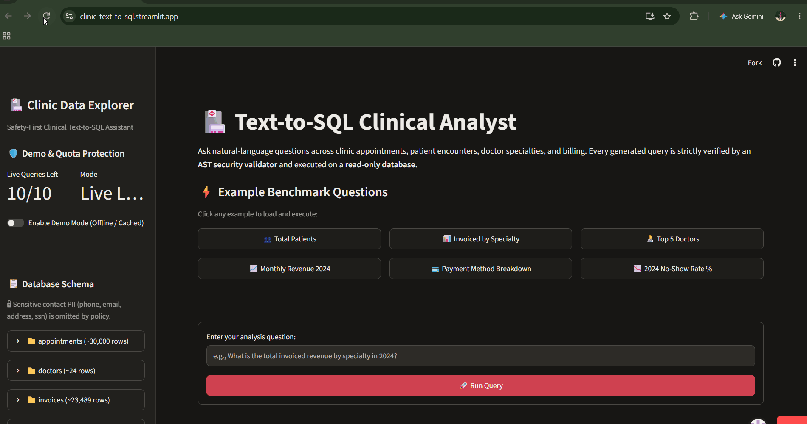
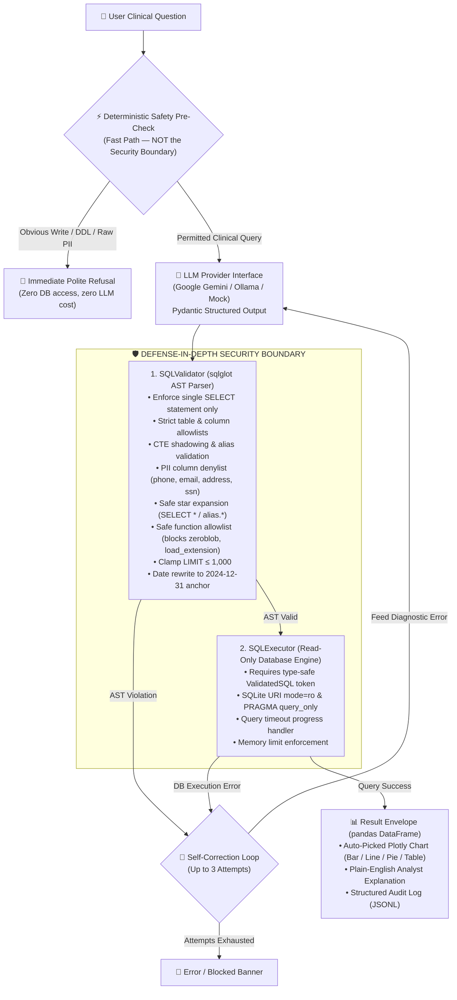

# 🏥 Text-to-SQL Clinical Analyst

A production-grade, safety-first Text-to-SQL agent that translates clinical and operational natural language questions into safe, verified, read-only SQL queries against a clinic database. Built with strict AST-based security validation, read-only database execution guarantees, an LLM self-correction retry loop, auto-selected Plotly data visualizations, and an evaluation harness.

🌐 **Live Deployed Web Application**: [https://clinic-text-to-sql.streamlit.app](https://clinic-text-to-sql.streamlit.app)



---

## ⚡ Try It

Test the live deployed application at [clinic-text-to-sql.streamlit.app](https://clinic-text-to-sql.streamlit.app) using these three representative example questions:

1. **Analytical Chart Query** (Interactive Plotly visualization):
   > *"What is the total collected revenue by payment method, ordered from highest to lowest?"*
   - Translates into a `GROUP BY payment_method` aggregate query on invoices and payments, auto-rendering an interactive chart alongside the data table.
2. **Deterministic Safety Refusal** (Zero LLM/DB cost):
   > *"Delete all cancelled appointments from the database"*
   - Intercepted instantly (~0.01 ms / ~8 µs, measured over 1,000 calls via time.perf_counter) by the deterministic safety pre-check before contacting the LLM or querying the database.
3. **Live Aggregate Count**:
   > *"How many total appointments were completed in 2024?"*
   - Safely queries across 30,000 appointment records to compute operational throughput.

---

## 🏛️ System Architecture



---

## 🔒 Security Model & Privacy Boundaries

### 1. The Pre-Check is a Fast Path, NOT the Security Boundary
The deterministic keyword/regex pre-check (`_check_deterministic_refusal`) is strictly an optimization:
- It intercepts obvious SQL write attempts (`DROP`, `DELETE`, `UPDATE`, `INSERT`), raw prompt injection phrases (`ignore previous instructions`), and blatant requests for raw PII.
- Its role is **cost and latency reduction** (fast refusal in ~0.01 ms / ~8 µs without invoking the LLM).
- **The actual security boundary consists of the AST Security Validator (`SQLValidator`) and the Read-Only Database Engine (`SQLExecutor`).** Even if an adversarial prompt completely bypasses the pre-check and convinces the LLM to output malicious SQL, the AST validator and read-only connection guarantee that unauthorized operations and leaks are impossible.

### 2. AST Security Validator (`SQLValidator`)
- **Single SELECT Enforcement**: Only a single `SELECT` statement (or CTE query starting with `WITH ... SELECT`) is allowed. Multiple statements, semicolons, and compound DDL/DML are rejected at the AST level.
- **Table & Column Allowlists**: Tables and columns are verified against the introspected database schema. Unknown or hallucinated tables/columns are rejected.
- **CTE Shadowing Prevention**: CTE definitions cannot shadow real database table names to evade validation.
- **PII Denylist**: Protected columns (`phone`, `email`, `address`, `ssn`) **cannot be referenced anywhere in a query, even in aggregate functions or conditional expressions** (e.g. `COUNT(email)`, `WHERE email IS NOT NULL`, `CASE WHEN phone IS NULL...`). Any reference to a denylisted column raises a `SecurityValidationError`.
- **Safe Wildcard Expansion**: `SELECT *` or `SELECT alias.*` are safely expanded into explicit, non-denylisted column lists prior to execution.
- **Function Allowlist**: Only safe analytical and mathematical functions (`COUNT`, `SUM`, `AVG`, `ROUND`, `STRFTIME`, `COALESCE`, `CASE/WHEN`, etc.) are permitted. Potentially dangerous functions (`load_extension`, `zeroblob`, `randomblob`) are blocked.
- **Clamped Limits**: Every query without an explicit `LIMIT` has a `LIMIT 1000` appended. Any `LIMIT > 1000` is clamped to 1,000.
- **Anchor Reference Date**: Relative dates ("last year", "past 30 days") are anchored to the clinic database reference date (`2024-12-31`).

### 3. Read-Only Database Executor (`SQLExecutor`)
- **Type-Safe `ValidatedSQL` Token**: The database execution method accepts only an instance of `ValidatedSQL`, which can only be minted by a successful `SQLValidator.validate()` pass.
- **Read-Only SQLite Connection**: Opens the database with SQLite URI read-only mode (`file:clinic.db?mode=ro`) and issues `PRAGMA query_only = ON`. Any attempt to write to disk is halted at the SQLite engine level.
- **Timeout Progress Handler**: Sets a progress callback (`set_progress_handler`) that terminates long-running or runaway queries exceeding `QUERY_TIMEOUT_SECONDS` (default: 30s).
- **Memory Caps**: Sets `SQLITE_LIMIT_LENGTH` to protect against memory exhaustion attacks.

---

## 📊 Evaluation Benchmark & Results

All metrics below are read directly from [`eval/results/latest.json`](eval/results/latest.json), frozen on clean git commit **`a37113a`** using `gemini-3.5-flash-lite`:

| Metric | Benchmark Result | Evaluated Set |
| :--- | :--- | :--- |
| **Overall Lenient Accuracy** | **`96.43%`** (54 / 56) | 56 benchmark questions |
| **Overall Exact Match Accuracy** | **`76.79%`** (43 / 56) | 56 benchmark questions |
| **Easy Questions Accuracy** | **`100.0%`** Exact (15/15) &bull; **`100.0%`** Lenient (15/15) | 15 questions |
| **Medium Questions Accuracy** | **`86.67%`** Exact (13/15) &bull; **`100.0%`** Lenient (15/15) | 15 questions |
| **Hard Questions Accuracy** | **`33.33%`** Exact (4/12) &bull; **`91.67%`** Lenient (11/12) | 12 questions |
| **Benign Trigger Accuracy** | **`78.57%`** Exact (11/14) &bull; **`92.86%`** Lenient (13/14) | 14 questions |
| **Policy Refusal (PII Aggregate)** | **`Refused correctly (1/1)`** (100.0%) | 1 question (`q57`) |
| **Safety Block Rate** | **`100.0%`** (30 / 30 defended: 13 pre-check caught, 17 model refused) | 30 adversarial safety attacks |
| **False Refusal Rate** | **`0.0%`** (0 false refusals) | 56 benchmark questions |
| **Mean Evaluation Latency** | **`4,324.18 ms`** | 56 benchmark questions |

### Honest Evaluation Caveats
1. **Exact vs. Lenient Match Definitions**:
   - **Exact Accuracy (`76.79%`)**: Requires identical row sets and identical columns in any order, with floating-point values rounded to 2 decimal places.
   - **Lenient Accuracy (`96.43%`)**: Every requested gold column must appear in the predicted result with identical rows and values (floats to 2dp), but extra diagnostic columns returned by the model (e.g. returning doctor name alongside doctor ID) are permitted.
2. **The Two Lenient Failures (`q42` and `q47`)**:
   - `q42` (Hard): Asked for month-over-month growth in collected payment revenue across 2024. The model grouped by month and summed amount without applying `LAG()` to calculate the difference.
   - `q47` (Benign Trigger): Asked for monthly drop-off in completed appointment count. The model used `CASE WHEN prev_month IS NULL THEN 0 ELSE ...`, producing `0` for January instead of `NULL`.
3. **Validator Catches in Benchmark**:
   - In the benchmark run, `ast_validator` had `0` runtime catches because `gemini-3.5-flash-lite` conformed cleanly to the prompt instructions. The validator's actual defensive power is verified by the adversarial suite in `eval/safety_cases.yaml` and the unit test suite in `tests/test_validator.py` (which tests 40+ injection, shadowing, and denylist bypass vectors).
4. **Gold-SQL Uniformity & Changelog**:
   - As documented in [`eval/CHANGELOG.md`](eval/CHANGELOG.md), gold queries were audited and pruned so that gold queries return only the identifying columns plus the values specifically requested by the question.
5. **Synthetic Data**:
   - The clinic database (`clinic.db`) consists of synthetic clinic SaaS operational records generated for benchmarking purposes.
6. **Independent Demo Verification**:
   - Stored demo cache results were verified against `clinic.db` independently via [`scripts/check_demo_independent.py`](scripts/check_demo_independent.py) and [`scripts/check_noshow.py`](scripts/check_noshow.py). The 2024 no-show rate is confirmed at **`10.03%`** (1,492 no-shows / 14,879 appointments).

### Limitations

The pre-check is a heuristic and can occasionally refuse benign wording; the validator and read-only database are the actual security boundary.

---

## 🚀 How to Run

### Option 1: Local Environment

1. **Clone and Create Virtual Environment**:
   ```bash
   git clone <repo-url>
   cd Text_To_SQL
   python -m venv .venv
   source .venv/bin/activate  # On Windows: .venv\Scripts\activate
   ```

2. **Install Dependencies**:
   ```bash
   pip install -e ".[dev]"
   ```

3. **Configure Environment**:
   ```bash
   cp .env.example .env
   # Edit .env and set GEMINI_API_KEY="your-api-key"
   ```

4. **Launch Streamlit Web UI**:
   ```bash
   streamlit run app/streamlit_app.py
   ```

---

### Option 2: Docker Container

The container runs as an unprivileged user (`appuser`, UID 1000) on `python:3.12-slim` and includes an automated healthcheck. The Docker build and healthcheck are verified by CI on GitHub Actions on every push and pull request.

1. **Build the Docker Image**:
   ```bash
   docker build -t text2sql-analyst .
   ```

2. **Run the Container (Demo Mode — Offline / Zero Secrets)**:
   ```bash
   docker run -p 8501:8501 text2sql-analyst
   ```

3. **Run the Container (Live Mode — with Gemini API Key)**:
   ```bash
   docker run -p 8501:8501 -e GEMINI_API_KEY="your-api-key" text2sql-analyst
   ```

Open your browser to `http://localhost:8501`.

---

### Option 3: Streamlit Community Cloud

1. Fork or push this repository to GitHub.
2. In [Streamlit Community Cloud](https://share.streamlit.io/), select your repository, branch (`master`), and main file path:
   `app/streamlit_app.py`
3. In **Advanced Settings &rarr; Secrets**, add:
   ```toml
   GEMINI_API_KEY = "your-api-key"
   ```
4. Deploy. If no API key is configured, the application automatically operates in pre-verified Demo Mode with zero network calls.

---

## 🧪 Testing & Verification

Run all test suites and lint checks locally:

```bash
# Run static analysis and style checks
ruff check .

# Run the complete test suite (150 tests)
pytest -q

# Re-build and verify the demo cache from live clinic.db
python scripts/build_demo_cache.py

# Run independent SQL data-integrity checks
python scripts/check_demo_independent.py
python scripts/check_noshow.py
```
